# Book Ordering System for Primary Schools

A Java desktop application for managing book orders for primary schools, developed using a client-server architecture.

## Overview

The Book Ordering System is a desktop application designed to help bookstore employees manage books, customers, and orders for primary school textbooks and other educational materials.

The application provides functionalities for maintaining a book catalog, managing customer information, processing orders, and automatically calculating order totals and applicable discounts.

The system follows a client-server architecture, separating the graphical user interface, business logic, and shared data models into three independent Java projects.

## Key Features

- **User Authentication** – Login and logout functionality for bookstore employees.
- **Book Management** – Add, update, delete, and search for books.
- **Customer Management** – Add, update, delete, and search for customers.
- **Category Management** – Manage customer categories and associated discount rates.
- **Order Management** – Create, search, update, and delete book orders.
- **Order Items Management** – Add books to orders, specify quantities, and remove order items.
- **Automatic Price Calculation** – Calculate order amounts, discounts, and final prices.
- **Discount System** – Apply discounts based on customer categories:
  - Individual customer: 5%
  - Large family: 10%
  - School: 15%

## Application Screenshots

### Server and Login

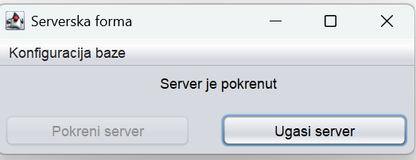
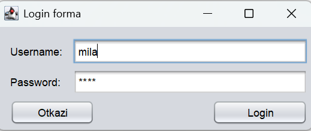

### Order Creation

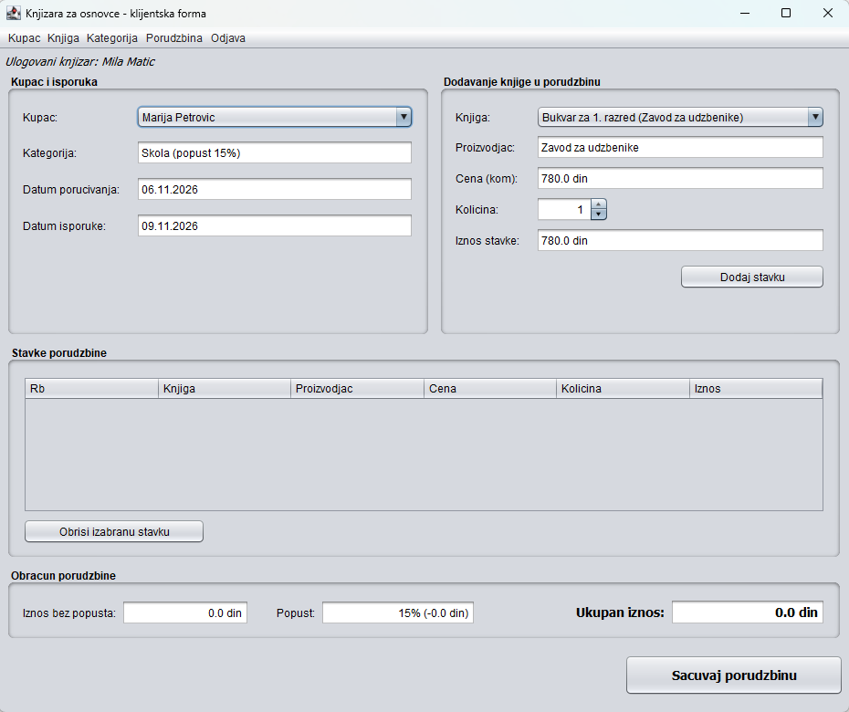
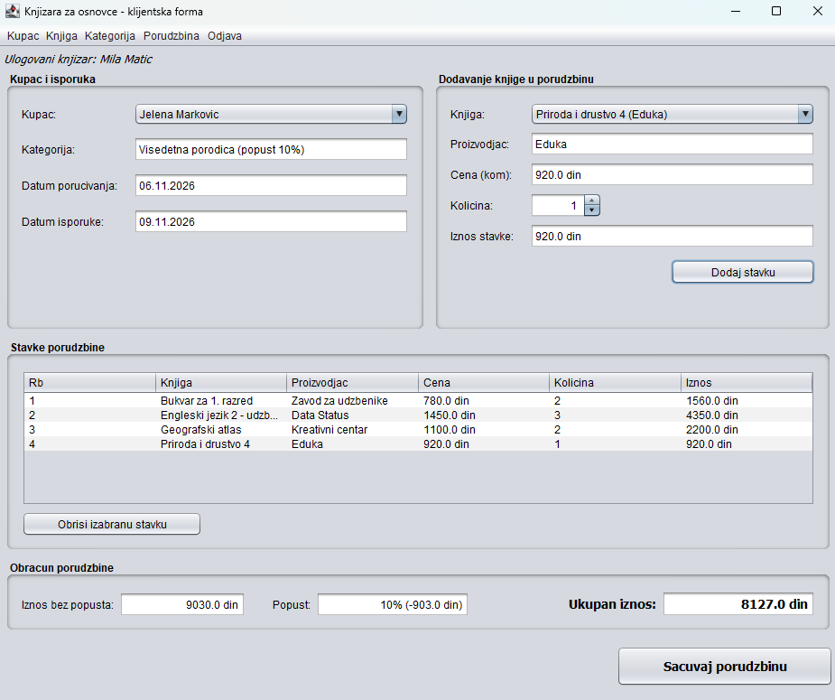

### Customer Management

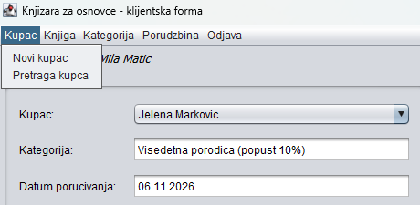
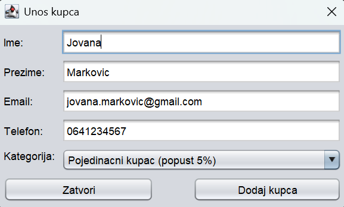
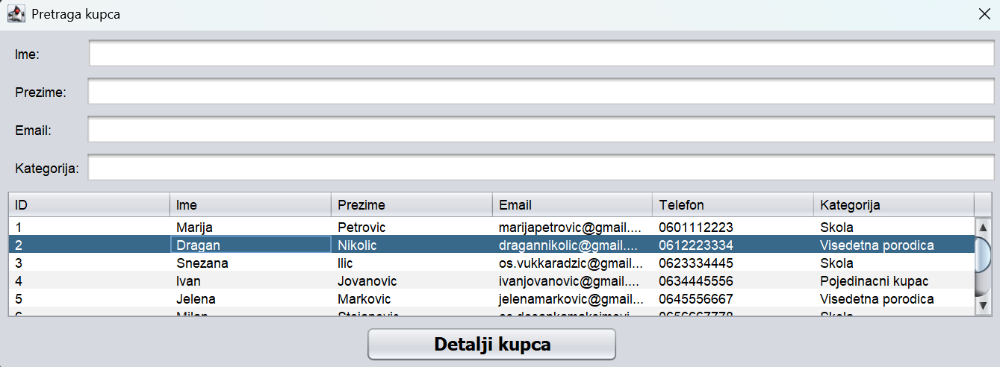
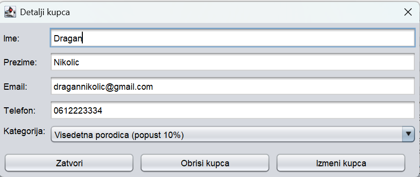

### Book Management

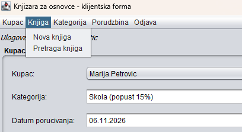
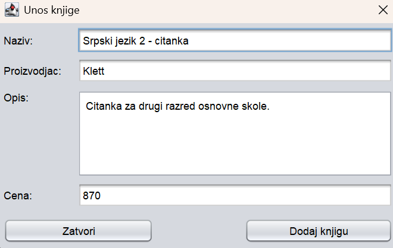
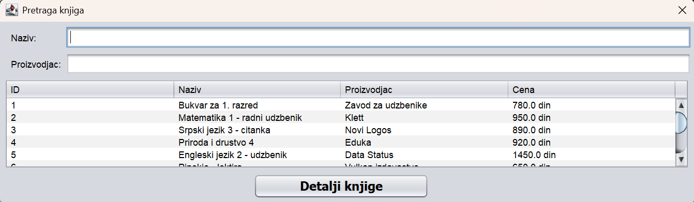
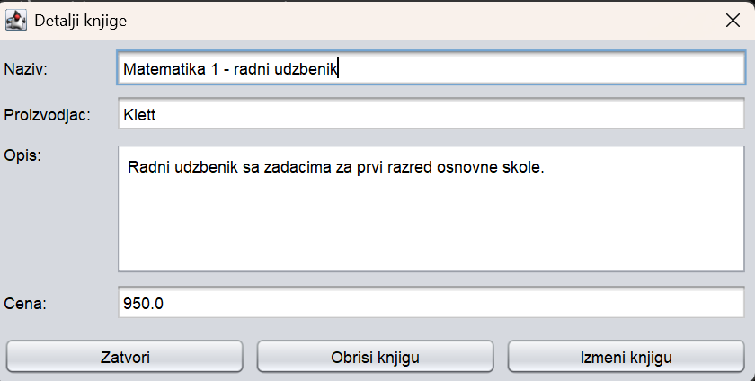

### Order Management

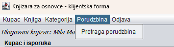
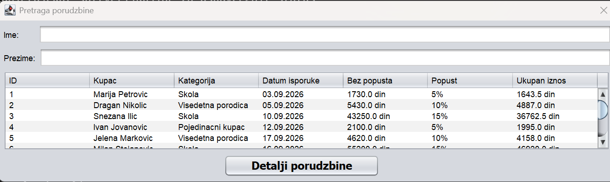
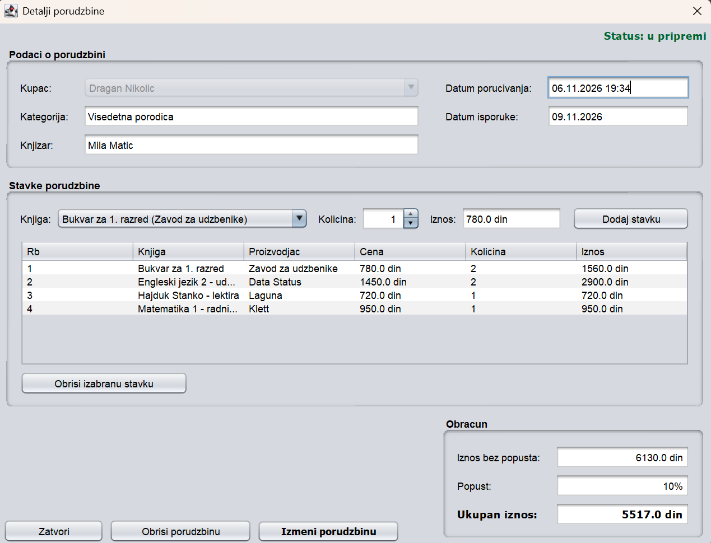
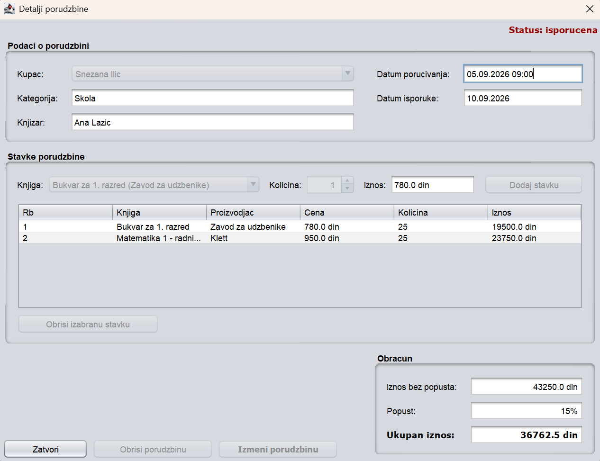
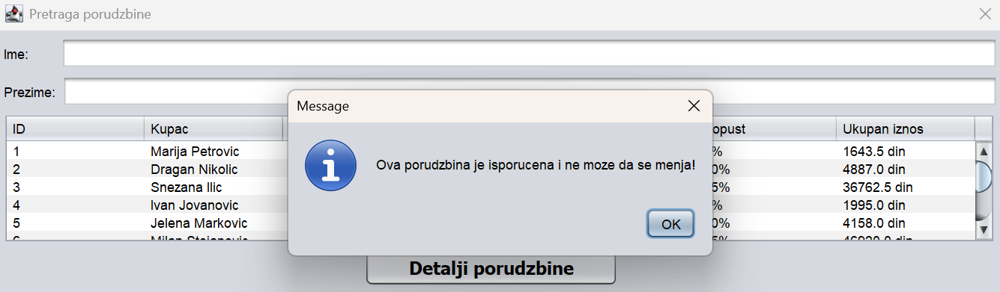

## System Architecture

The application consists of three independent Java projects:

### 1. KnjigeKlijent (Client)

The client application provides the graphical user interface developed using Java Swing.

Its main responsibilities include:
- User authentication.
- Displaying and managing books, customers, and categories.
- Creating and managing orders.
- Managing individual order items.
- Displaying calculated prices and discounts.
- Sending requests to the server and processing responses.

### 2. KnjigeServer (Server)

The server processes client requests, executes business operations, and communicates with the database.

Its main responsibilities include:
- Processing authentication requests.
- Executing business logic through system operations.
- Managing books, customers, categories, and orders.
- Performing database operations using JDBC.
- Handling multiple client connections using separate threads.
- Managing database transactions.

### 3. KnjigeZajednicki (Shared Module)

This project contains classes shared between the client and server.

It includes:
- Domain classes representing application entities.
- Request and Response classes for client-server communication.
- Operation definitions.
- Response status definitions.

## Client-Server Communication

The client and server communicate using Java Sockets over TCP.

The application uses Java object serialization to exchange Request and Response objects.

The server listens on port `9000` and handles incoming client connections using separate threads.

## Technologies Used

| Technology | Purpose |
|---|---|
| Java | Application development |
| Java Swing | Graphical user interface |
| MySQL / MariaDB | Relational database |
| JDBC | Database connectivity |
| Java Sockets | Client-server communication |
| Java Serialization | Object exchange |
| Multithreading | Handling client connections |
| Apache NetBeans | Development environment |
| Apache Ant | Project build automation |

## Database

The application uses a relational database named `knjige`.

The main database tables include:

- `Knjizar` – Bookstore employee information.
- `Diploma` – Educational qualifications.
- `KnjizarDip` – Employee qualifications.
- `Kategorija` – Customer categories.
- `Kupac` – Customer information.
- `Knjiga` – Book catalog.
- `Porudzbina` – Order information.
- `StavkaPorudzbine` – Individual items within an order.

The `knjige.sql` file contains the database creation script, table definitions, relationships, and sample data.

**Note:** The SQL script contains table deletion and creation statements. Import it into a test database or back up existing data before execution.

## Project Organization

The application is divided into three Java projects. `KnjigeKlijent` contains the graphical user interface, `KnjigeServer` handles client requests and database operations, while `KnjigeZajednicki` contains classes used by both the client and server.

The repository also includes the `knjige.sql` script for database creation and the `docs/screenshots` directory with screenshots of the application.

## Installation and Setup

### Prerequisites

- Java Development Kit (JDK) compatible with the project's Java 8 source and target settings.
- Apache NetBeans IDE.
- MySQL or MariaDB server.
- MySQL Connector/J JDBC driver.

### 1. Clone the repository

```bash
git clone https://github.com/milaa2506/school-book-ordering-system.git
```

### 2. Set up the database

Import the `knjige.sql` script into your MySQL or MariaDB environment.

The script creates the `knjige` database, its tables, relationships, and sample records.

### 3. Configure the database connection

Open the `KnjigeServer` project in Apache NetBeans.

Run the server application and open the database configuration form.

Enter the database name, MySQL username, and password.

The connection settings are saved locally in `dbconfig.properties`, which is excluded from version control.

### 4. Build the projects

Open the three projects in Apache NetBeans.

Build them in the following order:

1. `KnjigeZajednicki`
2. `KnjigeServer`
3. `KnjigeKlijent`

The shared project must be built first because the client and server depend on its generated JAR file.

Make sure the MySQL Connector/J library is correctly referenced by the server project.

### 5. Run the application

1. Start the `KnjigeServer` application.
2. Configure the database connection if necessary.
3. Start the server.
4. Run the `KnjigeKlijent` application.
5. Log in using an existing bookstore employee account from the database.

The client is configured to connect to the server through `localhost` on port `9000`.

